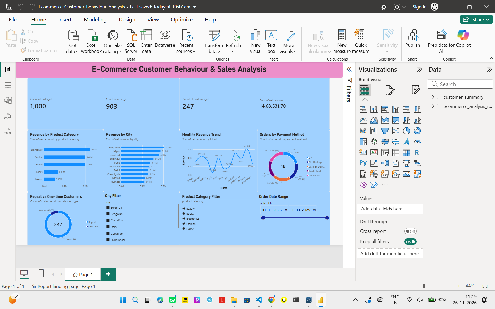

# E-Commerce Customer Behaviour & Sales Analysis

## Project Overview
This project focuses on analysing e-commerce sales data and customer purchasing behaviour using SQL, Python (Pandas), and Power BI.

The objective is to identify sales trends, understand customer behaviour, evaluate product category performance, and create an interactive dashboard to support data-driven business decisions.

## Tools & Technologies
- **SQL (MySQL):** Data analysis, aggregations, filtering, grouping, and subqueries.
- **Python:** Data cleaning, validation, and analysis using Pandas.
- **Power BI:** Interactive dashboard development and data visualization.
- **Microsoft Excel / CSV:** Dataset handling.

## Dataset Information
- Dataset type: Synthetic practice dataset
- Total records: 1,000 orders
- Unique customers: 247
- Time period: January–November 2025
- Fields include order date, customer ID, gender, age, city, product category, product name, quantity, unit price, discount, payment method, device type, and order status.

## Project Workflow

1. Created and loaded the e-commerce dataset into MySQL.
2. Performed SQL queries to analyse orders, revenue, customers, payment methods, and monthly trends.
3. Used Python and Pandas to validate the dataset and calculate sales metrics.
4. Created summary datasets for visualization.
5. Developed an interactive Power BI dashboard with KPI cards, charts, and slicers.

## Key Business Insights

- **Total Orders:** 1,000
- **Unique Customers:** 247
- **Delivered Orders:** 903
- **Delivered Revenue:** ₹1,468,531.70
- **Repeat Customers:** 222
- **One-time Customers:** 25

### Additional Findings
- Electronics generated the highest delivered revenue (₹443,850.55).
- Bengaluru recorded the highest delivered revenue (₹204,068.80).
- Jaipur recorded the highest number of orders (117).
- October 2025 had the highest monthly delivered revenue.
- UPI was the most frequently used payment method.

## Power BI Dashboard

The interactive dashboard includes:

- Total Orders
- Unique Customers
- Delivered Orders
- Delivered Revenue
- Revenue by Product Category
- Revenue by City
- Orders by Payment Method
- Monthly Revenue Trend
- Repeat vs One-time Customers
- City, Product Category, and Order Date slicers

## Project Files

- `01_create_and_load_database.sql` – Database and table creation with data loading.
- `02_analysis_queries.sql` – SQL analysis queries.
- `analysis.py` – Python data analysis script.
- `ecommerce_orders_1000.csv` – Original dataset.
- `ecommerce_analysis_ready.csv` – Analysis-ready dataset.
- Summary CSV files – Category, city, payment, monthly, and customer summaries.
- `Ecommerce_Customer_Behaviour_Analysis.pbix` – Power BI report.
- `Ecommerce_Customer_Behaviour_Analysis.pdf` – Dashboard PDF export.
- `TABLE_SCHEMA.txt` – Database table structure.

## Learning Outcomes

Through this project, I practised:
- SQL-based data analysis.
- Data validation and cleaning using Python.
- Exploratory data analysis.
- KPI calculation and business insight generation.
- Interactive dashboard development in Power BI.

---

**Project Status:** Completed

**Note:** This project uses a synthetic dataset for learning and portfolio demonstration.
